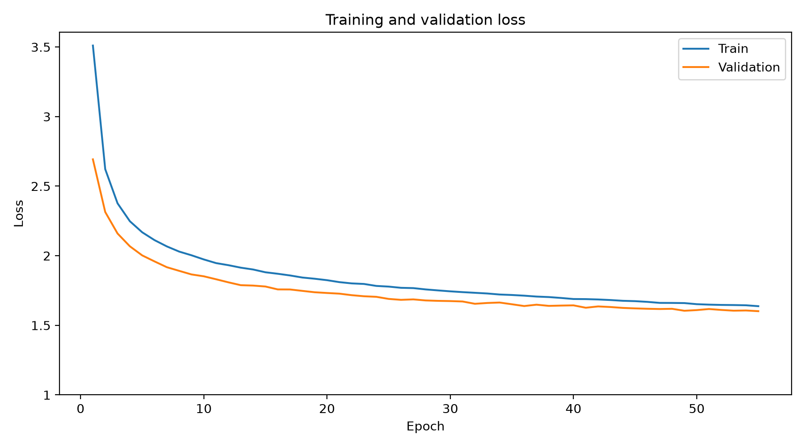
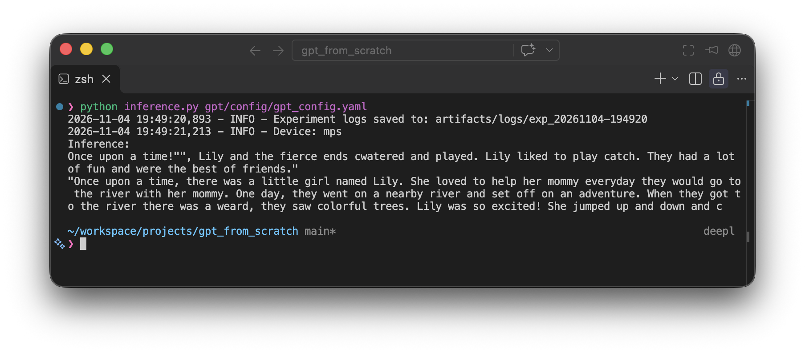

# GPT from scratch
<div style="display: flex; gap: 5px;">
<a href="https://cdn.openai.com/research-covers/language-unsupervised/language_understanding_paper.pdf">

</a>
</div>

Implementing ["Improving Language Understanding
by Generative Pre-Training"](https://cdn.openai.com/research-covers/language-unsupervised/language_understanding_paper.pdf) from scratch.

### Clone and install dependencies
``` 
git clone https://github.com/alessiopiroli/gpt_from_scratch
pip install -r requirements.txt 
```

### Train tokenizer
```
python train_tokenizer.py gpt/config/gpt_config.yaml
```

### Train
```
python train.py gpt/config/gpt_config.yaml
```

### Inference
```
python inference.py gpt/config/gpt_config.yaml
```

### Training and evaluation losses
<p align="center">
  
</p>

### Qualitative results
> Sample generated by the trained model, trained on a subsample of the [TinyStories](https://arxiv.org/pdf/2305.07759) dataset

<p align="center">
  
</p>